# Wind Turbine Predictive Maintenance: catching faults before the alarm

**Early fault detection for wind turbines from SCADA data.** Machine-learning models learn how hot each
component *should* run given wind, load and weather. When a turbine runs persistently hotter than its
healthy sister turbines, the tool raises an alarm, weeks before the turbine's own alarm system or a breakdown.

Built as a reusable tool (`predmaint`): validated on a public 5-turbine wind farm, and configurable
for any wind farm's SCADA export with one YAML file.

> **Results on unseen data (2013–2014, trained on 2012):**
> - **3 of 3** major outages with data got an early warning. The 107-day outage of turbine T84 was flagged **30 days** ahead.
> - **4 of 8** turbine-specific overheating alarms were preceded by a warning, a median of **26 days** early.
> - A turbine with a chronically overheating gearbox (T81) was found from the training year alone, by fleet screening.
> - At the same false-alarm rate, the model beats both a per-turbine model and raw temperature limits.

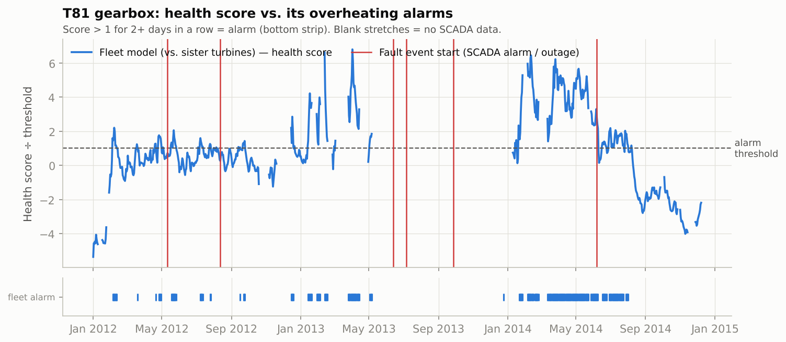
*T81's gearbox runs increasingly hotter than its sister turbines from late 2012 and alarms for weeks before its June 2014
overheating season (red lines). After August 2014 it drops to below its 2012 level, consistent with a repair.*

---

## Why it matters

Operations and maintenance are one of the largest cost items over a wind farm's life, and **unplanned**
failures are the expensive kind: a crane has to be mobilised at short notice, spare parts wait in a queue, and
the turbine earns nothing while it stands still. Gearbox, generator and bearing failures cause the
longest stops. Most of them announce themselves weeks in advance as a slow rise in temperature, if you know what
"normal" looks like for the current wind, load and weather.

For an asset owner, weeks of warning turn a breakdown into a planned job: order parts, book the crane for a calm
day, schedule it with other work, and avoid the secondary damage of running a failing component to destruction.
This is **condition-based** maintenance. Calendar-based maintenance can't do this.

## Data

| | |
|---|---|
| **Dataset** | Fuhrländer FL2500 wind farm: 5 turbines × 2.5 MW, Jan 2012 – Dec 2014 |
| **Content** | 5-min SCADA (78 sensors × min/max/mean/std) + controller alarm log (369 alarm codes, start/end, availability) |
| **Source** | [github.com/alecuba16/fuhrlander](https://github.com/alecuba16/fuhrlander), author Alejandro Blanco-M. |
| **License** | Eclipse Public License v2.0, as stated by the author. Data is downloaded by a script and **not** redistributed here |

The data is public and openly licensed. No employer or client data is used. Raw data is never committed:
`scripts/download_data.py` fetches it (pinned version, SHA-256 checked).

**Fault labels**, built from the alarm log and power data (`scripts/prepare_fuhrlander.py`):
- *Temperature alarms*: the controller's own high-temperature warnings and trips per component
  (gearbox, main bearing, generator, transformer). The goal is to see them coming earlier.
- *Major outages*: the turbine produced < 10 % of the fleet median for ≥ 5 days while the rest of the fleet was running.

**Data issues found and handled:** no SCADA data from June to November 2013; about 3,400 alarm records with the year
typed as 2017; sensor dropouts logged as 0 °C; and days where T84's logger scrambled its channels (gearbox
reading 33 °C at full power), right before its big outage. Those days are masked so they can't pose as an early warning.

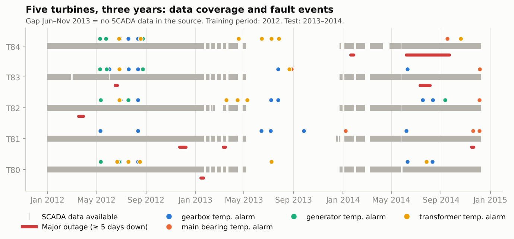

## Approach

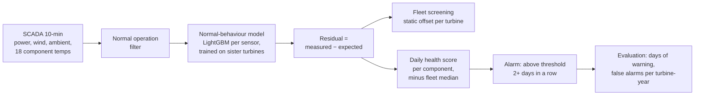

1. **Cleaning and EDA.** Resample to 10 minutes, mask invalid data, and keep only normal operation for training.
   *Insight:* 53 % of gearbox alarm days are shared by several turbines on the same hot day. That's a
   fleet-wide design or cooling limit, not a fault. T81 is the exception: 73 % of its alarm days are its own
   ([chart](reports/figures/11_alarm_attribution.png)).
2. **Normal-behaviour model.** A LightGBM regressor per temperature sensor predicts the expected temperature
   from load, 1 h / 3 h average load, wind speed, generator speed and ambient temperature. In **fleet mode**, turbine *A*
   is judged by a model trained on the *other* turbines, which answers "how hot would a healthy sister turbine run right
   now?". Median error on healthy test data: **2.0 °C** (vs. 4.4 °C for a plain average).
3. **Anomaly detection on the residuals.** Each turbine's typical offset in the training year is reported as
   **fleet screening** and then removed, so monitoring tracks *change*. Residuals become a daily health score per
   component. The fleet's daily median is subtracted (common-mode rejection: weather or ageing that hits all
   turbines is not a fault), the score is smoothed, and an alarm is raised when it stays above a threshold set on the training year.
4. **Failure prediction.** A classifier estimates the probability of a fault event in the next 14 days, compared
   against an honest seasonal baseline.
5. **Evaluation.** Days of early warning per event, and false-alarm episodes per turbine-year, on 2013–2014 data
   the models never saw. Strict time split, thresholds from training data only.

## Results

| Approach (test 2013–14) | Major outages warned | Turbine-specific temp. alarms warned | False alarms / turbine-year* |
|---|---|---|---|
| **Fleet model (this project)** | **3/3**, median 9 days (T84: 30 days) | **4/8**, median 26 days | 6.9 |
| Self model (each turbine vs. its own history) | 2/3, median 25 days | 4/8, median 26 days | 9.2 |
| No model (raw temperature thresholds) | 3/3, median 14 days | 4/8, median 26 days | 9.6 |

\*Alarm episodes across all 5 monitored components that were not followed by an event within 30 days.
Full tables: [`reports/results_fuhrlander.md`](reports/results_fuhrlander.md).

**Fleet screening finds "which turbine is different" from the training year alone:**

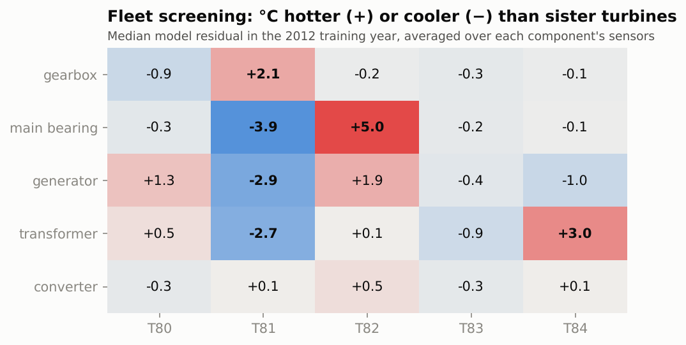

**T84 flagged a month before its 107-day converter/pitch outage:**

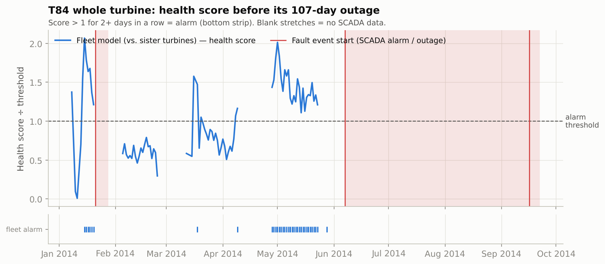

**The fair comparison is at equal false-alarm rate.** Each dot is one threshold, all set on training data. The fleet
model catches all 3 outages at 4.8 false alarms per turbine-year. The self model never reaches 3/3 below 7.6, and raw
temperature limits not below 9.6.

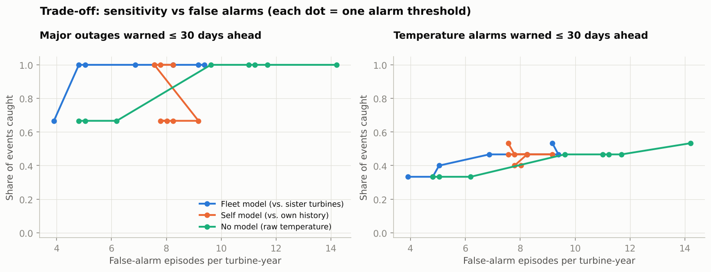

**Failure prediction (14-day horizon):** season and load alone reach ROC AUC 0.61, because many alarms are just hot summers.
Adding the health scores lifts this to **0.68**. The health scores help, but they flag a degrading turbine for weeks rather than
pinpointing a date, so the 30-day early-warning alarm is the more useful output for maintenance planning.

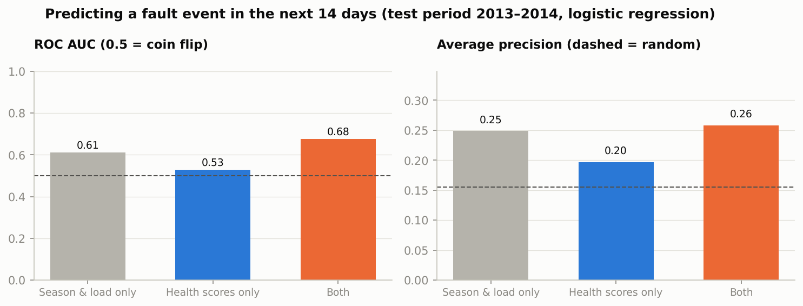

<details>
<summary>More charts: model fit, accuracy per sensor, lead time per event</summary>

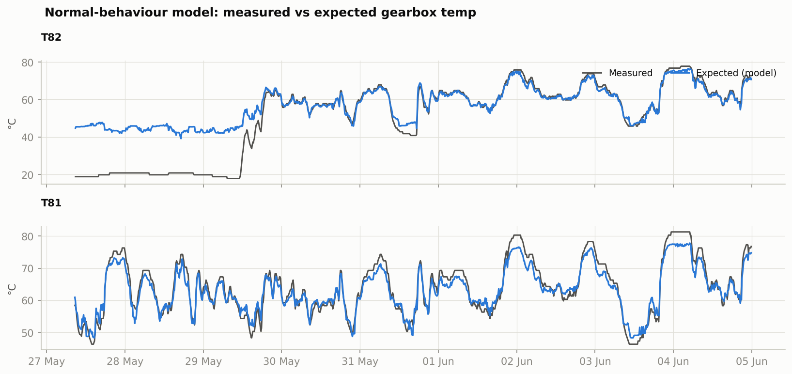
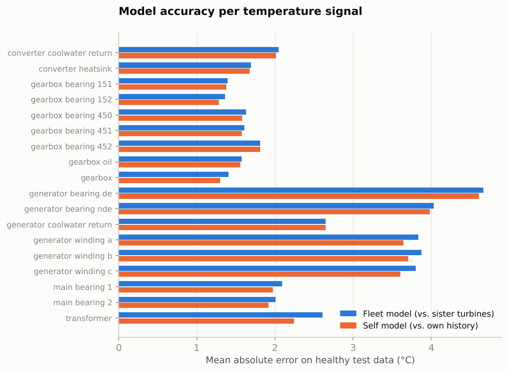
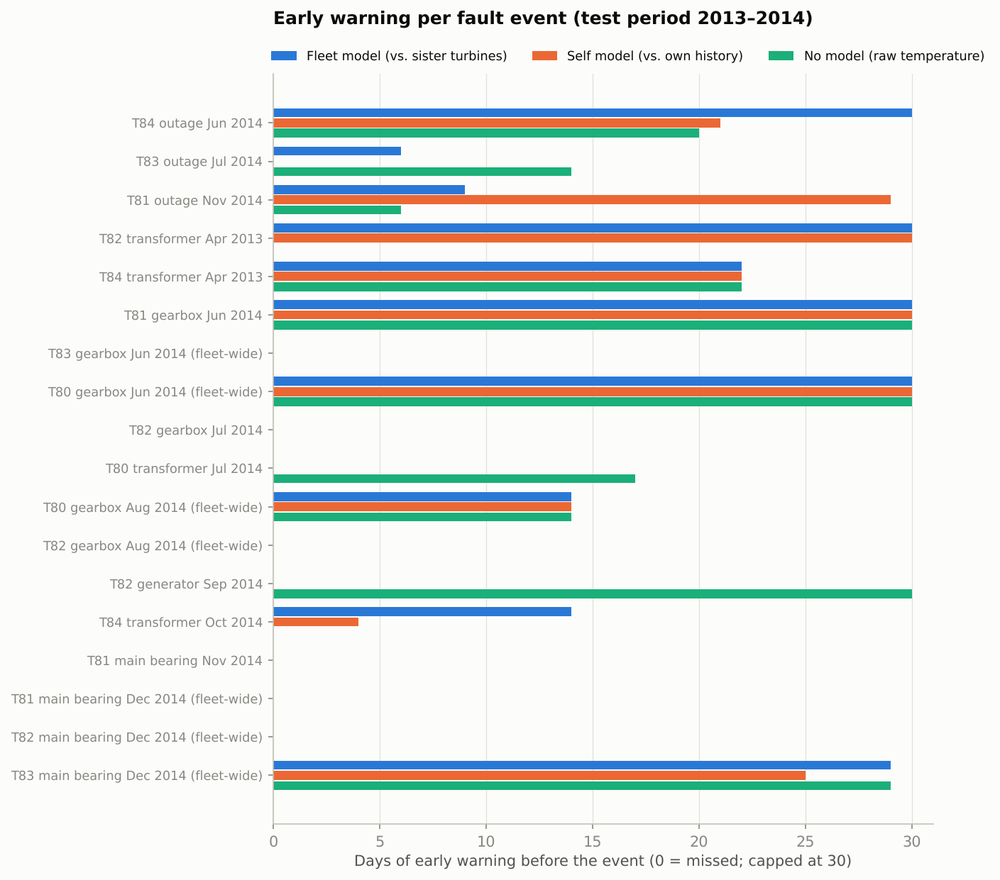
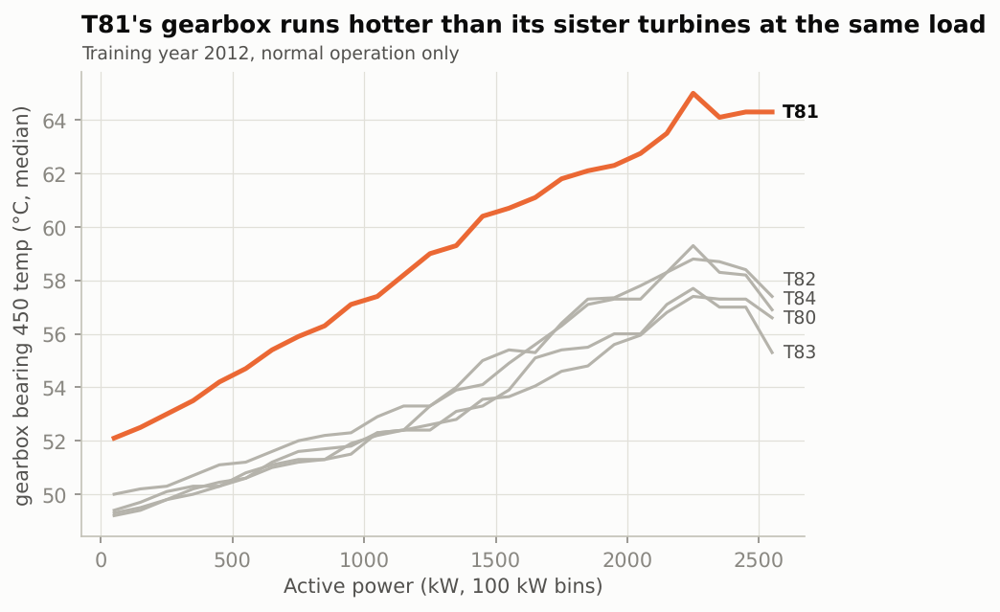
</details>

### What the numbers do and don't say
- **Small sample.** 18 scorable test events; 20 more lack enough SCADA data (13 of them fall in the 2013 data gap). Treat percentages as indicative.
- **Labels are proxies.** The public data has alarm logs, not work orders, so "fault" means a controller temperature alarm or a ≥ 5-day outage.
  The drop in T81's score after August 2014 suggests a repair, but there's no maintenance log to confirm it.
- **False alarms are the real cost.** About 7 alarm episodes per turbine-year means one check every ~7 weeks per turbine. That's workable
  for a remote analyst, but it's the main thing to improve.

## How to run

```bash
pip install -r requirements.txt && pip install --no-deps -e .
```
```bash
python scripts/download_data.py        # ~355 MB into data/raw/ (git-ignored)
```
```bash
python scripts/prepare_fuhrlander.py   # ~3 min: clean tables + fault events
```
```bash
python -m predmaint run --config configs/fuhrlander.yaml   # ~10 min: models, alarms, evaluation, figures
```
```bash
python -m predmaint.prediction configs/fuhrlander.yaml     # failure-prediction experiment
```
```bash
pytest -q                              # 17 tests incl. a synthetic farm with an injected fault (no download needed)
```

Notebooks: [`01_eda.ipynb`](notebooks/01_eda.ipynb) (data, cleaning, labels) and
[`02_model_and_evaluation.ipynb`](notebooks/02_model_and_evaluation.ipynb) (model, alarms, results).

### Use it on your own wind farm
1. Export SCADA as CSV or Parquet: timestamp, turbine id, power, wind speed, ambient temperature, component temperatures.
   An event log is optional and only needed for evaluation.
2. Copy [`configs/template.yaml`](configs/template.yaml), map your column names, and group sensors by component.
3. Train and evaluate on your history, then score new data with the saved models:
```bash
python -m predmaint run --config configs/my_farm.yaml
```
```bash
python -m predmaint score --config configs/my_farm.yaml --input last_month.csv --out alarms.csv
```
You need about a year of mostly healthy history, and at least 3 turbines of the same model for fleet mode.

### Interactive dashboard
`dashboard/` is a React + Tailwind 4 front end built with my PV UI kit (`dashboard/src/kit/`). You can pick a turbine
and a component, move the alarm level and see the alarms change, and explore the fleet screening and the events. It builds into
one self-contained HTML file:
```bash
python scripts/export_dashboard_data.py   # after `predmaint run`: results -> dashboard/src/data/
```
```bash
cd dashboard && npm ci && npm run build   # -> dashboard/dist/index.html (open it directly)
```

## Project structure
```
configs/        fuhrlander.yaml (demo) · template.yaml (your data)
scripts/        download_data.py · prepare_fuhrlander.py (dataset adapter)
src/predmaint/  config · data · features · nbm (models) · anomaly · evaluation · prediction · pipeline · report · CLI
notebooks/      01_eda · 02_model_and_evaluation
dashboard/      React + Tailwind front end (PV UI kit), builds to one HTML file
reports/        figures/ · results and metrics (generated)
tests/          unit tests + synthetic end-to-end test
```

## What I'd do next
- **Benchmark on CARE to Compare** (Fraunhofer IEE, CC BY-SA 4.0): 36 turbines and 44 documented faults with exact dates.
  It only needs a new adapter script. It isn't used yet because the hosting site (Zenodo) was blocked in my cloud environment.
- **Cut false alarms**: per-component thresholds tuned to repair cost, alarm suppression during curtailment, and
  combining alarms across sensors with a multivariate model (e.g. an autoencoder).
- **Vibration and oil data** where available: they detect bearing damage earlier than temperature.
- **Link to money**: rank alarms by expected avoided cost (component repair cost × probability × lost production at forward prices).
- **PV inverters**: the same pattern (expected power from irradiance and module temperature) on NREL PVDAQ data.

## License
Code: MIT (see [LICENSE](LICENSE)). Data: Eclipse Public License v2.0, © Alejandro Blanco-M., not included in this repository.
